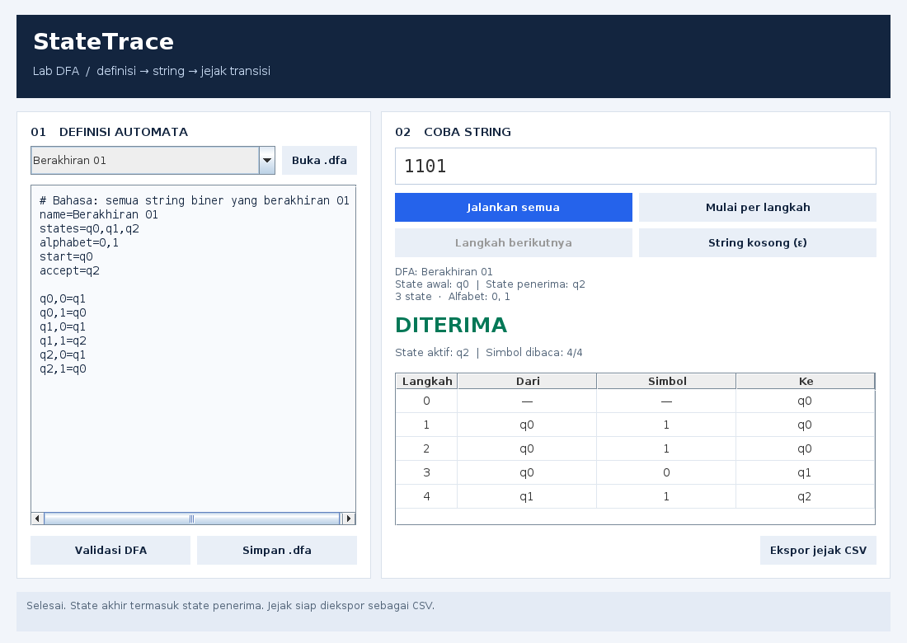

# StateTrace

Aplikasi desktop Java untuk mencoba **Deterministic Finite Automaton (DFA)**, melihat perpindahan state setiap simbol, dan mengekspor jejaknya sebagai CSV. Cocok untuk praktikum Teori Bahasa dan Otomata atau memeriksa rancangan DFA sebelum menggambarnya dalam laporan.

Proyek harian **1 November 2026**. Antarmuka dan dokumentasi berbahasa Indonesia; tidak memerlukan Maven, Gradle, server, atau paket eksternal.

## Fitur

- Editor definisi DFA dan dua contoh bawaan: string biner berakhiran `01`, serta string biner dengan jumlah `1` genap.
- Validasi kolom, state, alfabet, transisi ganda, dan kelengkapan seluruh transisi. State yang tidak terjangkau dilaporkan sebagai informasi.
- Jalankan seluruh string atau baca satu simbol per langkah; hasil akhir ditampilkan setelah seluruh input dibaca.
- String kosong, simbol Unicode satu code point, serta input hingga 4.096 simbol.
- Tabel jejak dengan state awal pada langkah 0 dan state aktif saat ini.
- Perubahan definisi/input otomatis membersihkan hasil lama agar jejak tidak tertukar.
- Buka/simpan `.dfa` dan ekspor jejak lengkap ke CSV UTF-8. Tujuan yang sudah ada tidak ditimpa.
- Mode CLI untuk penggunaan tanpa layar dan pemeriksaan otomatis.
- **JAR siap pakai** disertakan di `dist/statetrace.jar`.

## Tampilan



Gambar ini adalah hasil render komponen Swing aplikasi dalam mode headless, bukan tangkapan jendela native Windows/Linux. Komponen dan aksi panel diuji secara programatis; pengujian manual jendela native belum dilakukan.

## Persyaratan dan menjalankan GUI

Gunakan **Java 17 atau lebih baru** dengan dukungan desktop, misalnya JDK 17+. Pastikan `java -version` menunjukkan versi yang sesuai. Ekstrak ZIP atau clone repository, lalu buka folder proyek.

```sh
java -jar dist/statetrace.jar
```

Pada Windows, `run.bat` juga dapat diklik dua kali. Pada Linux/macOS, tersedia `sh run.sh`. Jika asosiasi file JAR sudah diatur pada sistem, JAR dapat dibuka langsung. JAR tidak perlu dibangun ulang untuk mulai mencoba.

1. Pilih contoh atau edit definisi di panel kiri.
2. Klik **Validasi DFA** untuk memeriksa definisi.
3. Isi string pada panel kanan. Gunakan tombol **String kosong (ε)** untuk menguji input panjang nol.
4. Klik **Jalankan semua**, atau **Mulai per langkah** lalu **Langkah berikutnya**.
5. Setelah selesai, **Ekspor jejak CSV** tersedia. Pilih nama file baru saat menyimpan.

Input peka huruf besar/kecil. Simbol di luar alfabet merupakan masukan tidak valid, bukan hasil penolakan bahasa. Mengganti contoh atau membuka file mengganti isi editor; simpan definisi yang ingin dipertahankan terlebih dahulu.

## Format definisi `.dfa`

Berkas UTF-8 berisi satu pasangan `kunci=nilai` atau satu transisi per baris. Baris kosong dan komentar yang diawali `#` diabaikan. Spasi di sekitar pemisah boleh digunakan. BOM dan CRLF didukung; tidak ada mekanisme escape atau komentar di akhir baris.

```text
name=Berakhiran 01
states=q0,q1,q2
alphabet=0,1
start=q0
accept=q2

q0,0=q1
q0,1=q0
q1,0=q1
q1,1=q2
q2,0=q1
q2,1=q0
```

| Bagian | Ketentuan |
| --- | --- |
| `name` | Wajib, 1–120 karakter, tanpa karakter kontrol atau pemisah `=`. |
| `states` | Wajib, 1–50 nama unik. Nama diawali huruf ASCII, maksimal 32 karakter; selanjutnya boleh huruf, angka, `_`, atau `-`. |
| `alphabet` | Wajib, 1–16 simbol unik. Tiap simbol satu Unicode code point, bukan satu rangkaian grapheme; whitespace, karakter kontrol, koma, `=`, dan `#` tidak didukung. |
| `start` | Wajib, tepat satu state yang terdaftar. |
| `accept` | Wajib, daftar state penerima. `accept=` berarti himpunan penerima kosong. |
| `asal,simbol=tujuan` | Wajib tepat satu untuk setiap pasangan state dan simbol alfabet; asal/tujuan harus terdaftar. |

Ukuran definisi maksimal 65.536 byte. DFA bersifat **total**: transisi yang hilang dianggap definisi belum lengkap; tambahkan sink state bila rancangan memerlukannya. Program tidak mendukung NFA atau transisi epsilon. Semua simbol diperlakukan sebagai karakter literal; input kosong adalah string panjang nol, bukan karakter `ε` yang diketikkan.

## Mode CLI

```sh
java -jar dist/statetrace.jar check examples/ends-01.dfa
java -jar dist/statetrace.jar run examples/ends-01.dfa 1101
java -jar dist/statetrace.jar run examples/even-ones.dfa ""
java -jar dist/statetrace.jar run examples/ends-01.dfa 1101 --csv jejak.csv
```

Untuk contoh `1101`, bagian akhirnya:

```text
0: q0 (state awal)
1: q0 --[1]--> q0
2: q0 --[1]--> q0
3: q0 --[0]--> q1
4: q1 --[1]--> q2
DITERIMA; state akhir: q2
```

Argumen string kosong pada contoh di atas digunakan dalam Bash/Command Prompt. Jika shell menghilangkan argumen kosong, gunakan tombol string kosong di GUI atau sesuaikan cara shell meneruskan argumen kosong ke Java.

| Exit code CLI | Arti |
| --- | --- |
| `0` | String diterima; atau check/render/help berhasil. |
| `1` | String valid, tetapi ditolak DFA. |
| `2` | Argumen, definisi, string, file, atau lingkungan GUI bermasalah. |

CSV berisi kolom `langkah,dari,simbol,ke`. Baris pertama data adalah state awal; kolom dari/simbolnya kosong. Simbol kutip di-escape dengan kutip ganda. CSV mengekspor jejak, sedangkan verdict ditampilkan pada GUI/CLI.

## Build dan pengujian

Untuk membangun ulang, diperlukan **JDK 17+**, termasuk modul compiler dan desktop. Dari folder proyek:

```sh
java Build.java
java Build.java test
```

Build memakai compiler API JDK dengan `--release 17`, `-Xlint:all`, dan `-Werror`. Semua source, termasuk tes, tersedia. `build/` adalah output sementara; `dist/statetrace.jar` merupakan artefak siap jalan.

Pemeriksaan tambahan JAR memakai Python 3 standar:

```sh
python tools/smoke.py
```

Untuk membuat pratinjau panel dari aplikasi dalam lingkungan tanpa layar, gunakan nama output baru:

```sh
java -Djava.awt.headless=true -jar dist/statetrace.jar render pratinjau.png
```

Perintah `render` menjalankan contoh `1101`, menata panel Swing, lalu merendernya ke PNG. Perintah ini tidak membuka jendela native. Hasil pengujian yang benar-benar dijalankan beserta keterbatasannya dicatat di [VERIFICATION.md](VERIFICATION.md).

Lisensi MIT.
